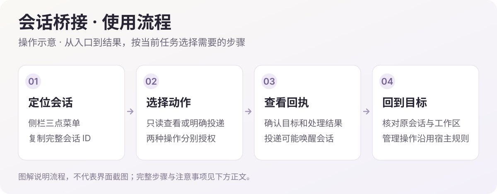

<h1>Session Bridge · 会话桥接</h1>

找到会话、传递消息，并让临时工作区各归其位。

  
  
  

<a href="#功能一览">功能一览</a> · <a href="#快速开始">快速开始</a> · <a href="#visual-guide">图解使用</a> · <a href="#使用场景">使用场景</a> · <a href="#常见问题">常见问题</a> · <a href="#详细文档">详细文档</a> · <a href="../README.en.md">English</a>

---

<!-- current-source -->
当前开发源码：**1.0.4** · [分支 `main`](https://github.com/Missher12/Missher-DSH-Session-Bridge/tree/main)。安装包以实际 Release 为准。
<!-- /current-source -->

## 功能一览

| 能做什么 | 说明 |
| --- | --- |
| **会话标识** | 从侧栏菜单复制完整会话 ID、工作目录与桥接引用。 |
| **跨会话协作** | 列出、读取或向明确指定的会话投递消息。 |
| **临时工作区** | 复用“不在工作区”入口，或为一次性工作创建独立目录。 |
| **移动与删除** | 在宿主提供相应生命周期接口时，使用拖放移动和确认删除。 |

## 快速开始

1. 从 [Releases](https://github.com/Missher12/Missher-DSH-Session-Bridge/releases/tag/v1.0.4) 下载对应版本的 `.tgz` 安装包。
2. 在 DSH **插件 → 添加插件** 中选择下载的文件，安装并启用；按宿主提示重新加载或正常重启。
3. 在侧栏会话的三点菜单中复制 ID；在聊天中使用 `/sessions` 或 `/bridge`。

<!-- visual-guide -->

## 图解使用流程

先定位明确的目标会话，再选择只读查看或明确投递。

[查看完整流程图](../docs/images/workflow-guide.svg)

| 步骤 | 怎样操作 | 需要留意 |
| --- | --- | --- |
| 1. 定位目标 | 在侧栏会话三点菜单复制完整 ID、工作目录或桥接引用。 | 使用完整 ID，避免把相似标题、当前聊天和目标会话混淆。 |
| 2. 只读参考 | 明确要求列出或读取目标会话，提取所需信息。 | 读取内容不等于给目标发消息；只读请求不要附带唤醒操作。 |
| 3. 明确投递 | 需要对方继续处理时，再说明目标 ID 与要发送的内容。 | 投递可能启动目标会话并产生模型费用，完成后检查回执。 |
| 4. 管理会话 | 使用临时工作区或宿主支持的移动、归档、删除入口。 | 生命周期能力由宿主提供；删除仍遵守原有确认规则。 |

### 试一次

> 只读查看会话 `<完整会话 ID>` 最近的交付结论，整理已完成与未解决事项。不向该会话投递消息。

使用后可以这样核对：

- 回执中的目标 ID 与预期一致。
- 只读操作与投递操作分开，没有误唤醒其他会话。
- 需要继续开发时确认真实工作目录，临时工作区不冒充原项目。

### 使用与配置

| 项目 | 建议 |
| --- | --- |
| 完整 ID | 以侧栏三点菜单提供的 ID 为准，不依赖会话标题猜测目标。 |
| 投递范围 | 消息应写清目标、上下文和需要的结果；不要把查询自动升级为派单。 |
| 会话管理 | 移动和删除等操作需要宿主相应能力；能力缺失时按提示处理。 |

<!-- existing-screenshots -->
### 界面示例

<table><tr><td></td><td></td></tr></table>

来自项目已有文档；截图版本与验证范围见<a href="../README.md">原始说明</a>，点击可放大。
<!-- /existing-screenshots -->

已有截图分别展示临时工作区和归档确认。完整 ID 的当前入口在侧栏三点菜单；旧版顶部布局不作为当前操作依据。
<!-- /visual-guide -->

## 使用前了解

- 跨会话投递会向目标发送真实消息，目标模型可能继续执行并产生费用。
- 永久删除不可撤销；缺少宿主原子接口时，相关操作会禁用并说明原因。

<!-- readme-expansion -->
## 使用场景

| 遇到的情况 | 怎样使用 |
| --- | --- |
| 多个相似标题的会话容易分不清 | 复制完整会话 ID、工作目录或桥接引用，明确指向同一个会话。 |
| 一个会话需要参考另一个会话的结果 | 在用户明确指定目标后列举、读取或投递消息，减少人工反复复制。 |
| 想做一次独立的小任务，暂时不加入现有项目 | 使用“不在工作区”的临时目录入口；移动和删除则按宿主实际提供的能力操作。 |

## 常见问题

为什么要用完整 ID，不能只写标题？

不同会话可以有相同标题。完整 ID 指向具体记录，尤其适合跨项目、归档记录或标题经常变化的场景。

为什么移动或删除入口不可用？

这些操作依赖宿主的生命周期接口。缺少能力时插件会降级或禁用入口，不绕过宿主直接删除私人日志；相关宿主补丁与普通插件包分开交付。

“不在工作区”会自动清空文件吗？

它实际仍是已登记的 scratch 工作区，并非自动销毁的沙箱。临时任务完成后，文件是否保留需要按自己的任务要求处理。

## 搭配使用

与 [Project Ops](https://github.com/Missher12/Missher-DSH-Project-Ops) 配合可以在明确会话后找到相关文件；与 [Superagent](https://github.com/Missher12/Missher-DSH-Superagent) 配合时，任务派发和生命周期仍由对应插件管理。

## 升级与数据

更新继续使用原会话标识与宿主数据。插件包不等于宿主删除／移动补丁；安装了插件也不意味着所有宿主都自动获得相同生命周期能力。
<!-- /readme-expansion -->

## 详细文档

[项目原说明](../README.md) · [兼容记录](../COMPATIBILITY.json) · [插件边界](../PLUGIN_BOUNDARIES.md) · [第三方声明](../THIRD_PARTY_NOTICES.md) · [许可证](../LICENSE)

原有功能细节、配置、截图与验证记录保留在上述文档中，历史结论按其注明的版本理解。
