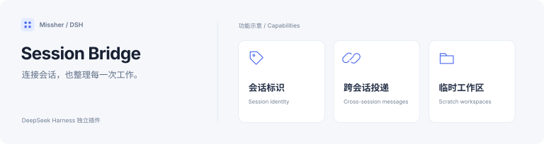
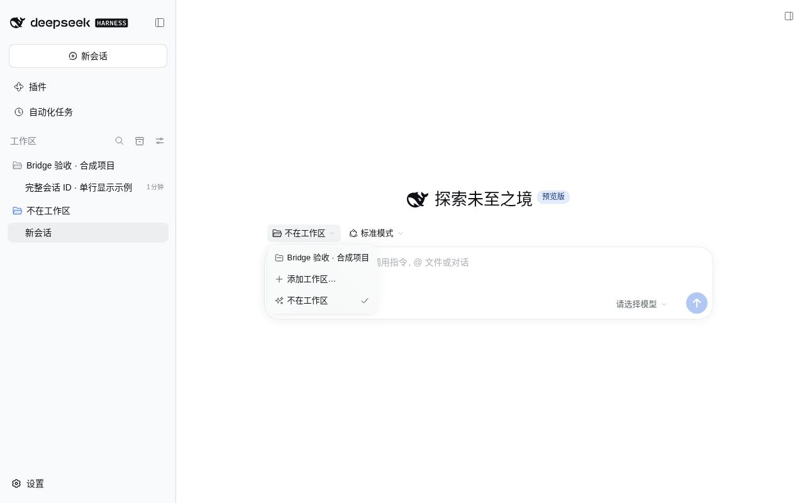
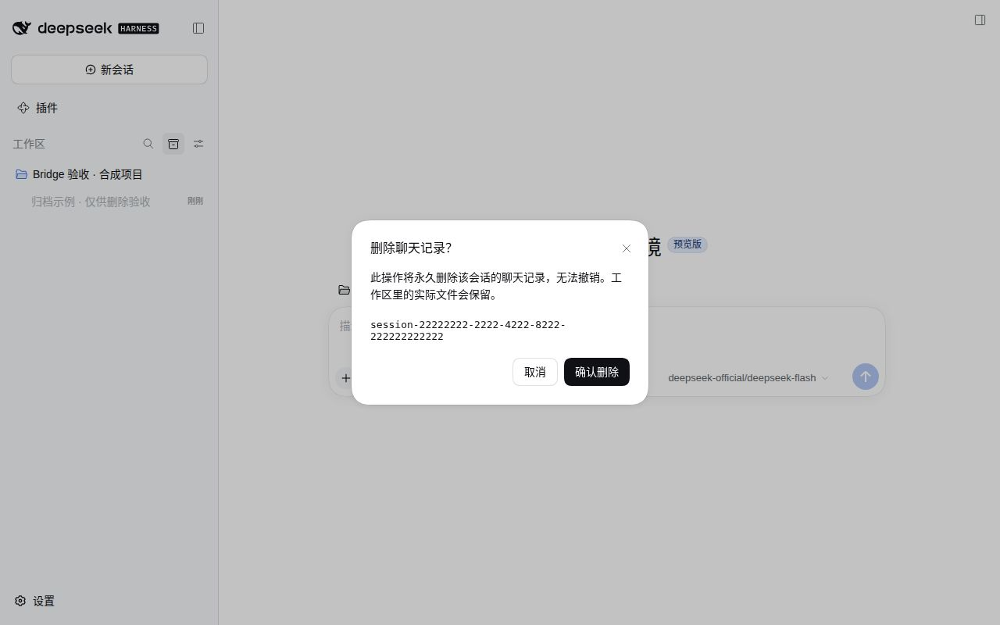

<h1>Session Bridge · 会话桥接</h1>

找到会话、传递消息，并让临时工作区各归其位。

  
  
  

<a href="#功能一览">功能一览</a> · <a href="#快速开始">快速开始</a> · <a href="#详细文档">详细文档</a> · <a href="../README.en.md">English</a>

---

<!-- current-source -->
当前开发源码：**1.0.2** · [分支 `main`](https://github.com/Missher12/Missher-DSH-Session-Bridge/tree/main)。安装包以实际 Release 为准。
<!-- /current-source -->

## 功能一览

| 能做什么 | 说明 |
| --- | --- |
| **会话标识** | 从侧栏菜单复制完整会话 ID、工作目录与桥接引用。 |
| **跨会话协作** | 列出、读取或向明确指定的会话投递消息。 |
| **临时工作区** | 复用“不在工作区”入口，或为一次性工作创建独立目录。 |
| **移动与删除** | 在宿主提供相应生命周期接口时，使用拖放移动和确认删除。 |

<!-- existing-screenshots -->
## 界面示例

<table><tr><td></td><td></td></tr></table>

来自项目已有文档；截图版本与验证范围见<a href="../README.md">原始说明</a>，点击可放大。
<!-- /existing-screenshots -->

## 快速开始

1. 从 [Releases](https://github.com/Missher12/Missher-DSH-Session-Bridge/releases/tag/v1.0.2) 下载对应版本的 `.tgz` 安装包。
2. 在 DSH **插件 → 添加插件** 中选择下载的文件，安装并启用；按宿主提示重新加载或正常重启。
3. 在侧栏会话的三点菜单中复制 ID；在聊天中使用 `/sessions` 或 `/bridge`。

## 使用前了解

- 跨会话投递会向目标发送真实消息，目标模型可能继续执行并产生费用。
- 永久删除不可撤销；缺少宿主原子接口时，相关操作会禁用并说明原因。

## 详细文档

[项目原说明](../README.md) · [兼容记录](../COMPATIBILITY.json) · [插件边界](../PLUGIN_BOUNDARIES.md) · [第三方声明](../THIRD_PARTY_NOTICES.md) · [许可证](../LICENSE)

原有功能细节、配置、截图与验证记录保留在上述文档中，历史结论按其注明的版本理解。
