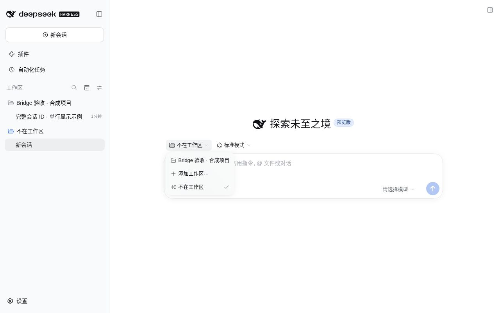
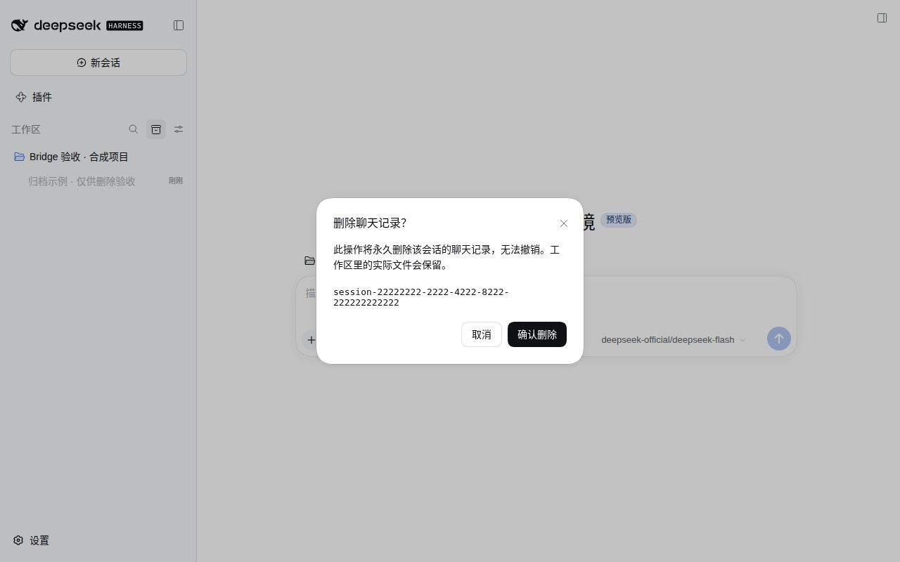

# Session Bridge · 会话桥接

中文 | [English](README.en.md) · [桌面端与安装包](https://github.com/Missher12/Missher-DeepseekHarness-Desktop) · [全部插件](https://github.com/Missher12/Missher-DeepseekHarness-Desktop/blob/main/plugins/README.zh.md)

为 DeepSeek Harness 显示与复制完整会话 ID，提供跨会话查询、读取和投递，以及临时工作区。

- 包名：`@missher/dsh-session-bridge`；版本：**0.1.5**（顶部 ID 已移至侧栏菜单）。
- 会话 ID 收在左侧会话的三点菜单里，顶部标题栏不再显示额外 ID 控件。
- 左侧三点菜单可复制完整 ID、工作目录或 `/bridge` 引用；归档记录带二次确认的删除入口。
- 独立、可卸载的 Cordis Bundle；不需要另装兼容插件。不是 DeepSeek 官方产品。
- [许可证](LICENSE) · [上游署名](THIRD_PARTY_NOTICES.md) · [兼容记录](COMPATIBILITY.json)

## 安装与更新

从 [Releases 页面](https://github.com/Missher12/Missher-DSH-Session-Bridge/releases) 选择 0.1.5，下载 `missher-dsh-session-bridge-0.1.5.tgz` 与 `SHA256SUMS`；版本与文件是否可下载以该页面为准。运行包包含编译结果，不要将 GitHub 自动生成的源码压缩包当作插件安装包。

下载后可在包含两个文件的目录校验：macOS 用 `shasum -a 256 -c SHA256SUMS`，Linux 用 `sha256sum -c SHA256SUMS`。运行包已包含 `lib`，无需本地构建，也没有安装脚本。

**Desktop：**打开“插件 → 添加插件”，选择本地 `.tgz` 或填写下面固定地址。确认版本及组件 `session-bridge` 已启用；按 Host 提示重新加载，必要时完全退出后重开。Desktop 的 `desktop` profile 由应用管理，使用应用内安装入口。

发布地址以 Release 页面上的标签为准，格式为
`https://github.com/Missher12/Missher-DSH-Session-Bridge/releases/download/<tag>/missher-dsh-session-bridge-0.1.5.tgz`。
在资产出现之前，请先用本地 tarball 的绝对路径安装。

**已有 DSH CLI 的 Web 用户：**在自己的 Web profile 安装；以下命令不修改 Desktop profile。

```sh
dsh plugin --profile web add /absolute/path/to/missher-dsh-session-bridge-0.1.5.tgz
```

发布后把本地路径换成上面的固定地址即可。首次测试使用独立 `DSH_HOME` / `DSH_AGENTS_HOME`。不要同时启用旧 `dsh-session-bridge`、开发别名 `session-bridge-dev` 和当前 scoped 包；它们会重复注册 `session_list` 等工具。升级前保留旧包与配置，等当前任务结束再重新加载。

## 使用

### 会话 ID 与菜单

在左侧找到目标会话，点击该行的三点菜单，选择“复制会话 ID”。复制结果保留完整 `session-` 前缀；菜单也能复制工作目录或 `/bridge <session-id> ` 引用。顶部只保留会话标题和其他操作，不再显示重复的 ID 控件或详情浮层。

操作读取被点击的会话，包括归档行，不切换当前会话；目录未加载或复制失败会给出提示。归档记录始终显示“删除会话…”入口。支持安全删除接口时，点击后再确认；不支持时禁用并显示原因。查询中、查询失败和宿主不支持会分别说明，重新打开菜单即可重查。若确认时宿主返回 501，弹窗明确说明不支持并禁止重复提交。

### 「不在工作区」与 scratch

新会话选择器末尾提供“✨ 不在工作区（临时目录）…”。选择后复用配置根目录下的 **`dsh-scratch` 工作区**，默认标题为“不在工作区”；macOS 的默认规范路径是 `/private/tmp/dsh-scratch`。它仍是**正式注册的工作区**，只是名字叫“不在工作区”，并不是真正无工作区的会话——宿主的 blank 会话输入流程需要工作区。

只打开选择器不会创建目录或会话。重复选择复用规范路径及真实工作区 ID，保留用户重命名；不合并其他同名项目。固定路径若是符号链接、非当前用户所有，或可被组/其他用户写入，创建请求会失败。

选择器末尾的“不在工作区”入口：



模型工具 `session_scratch` 和 `/scratch` 则为每次调用建立独立的一次性目录；这与界面复用 `dsh-scratch` 的行为不同。临时目录可能被操作系统清理，不适合作为重要文件的唯一保存位置。

### 工具与命令

| 模型工具 | 作用 |
| --- | --- |
| `session_list` | 列出会话 ID、标题、目录和运行状态；默认排除子代理会话。 |
| `session_read` | 读取目标最近的用户/助手文本，不含思维链和工具结果；只读，不唤醒目标。 |
| `session_send` | 向目标投递真实 user-role 消息；`steer` 在步骤边界送达、空闲时开始回合，`turn` 排队为独立回合。 |
| `session_scratch` | `session` 模式在独立临时目录创建会话；`directory` 模式不创建会话，但默认仍注册工作区，可用 `registerScratchWorkspace: false` 关闭。 |

目标接受精确 ID、忽略大小写的精确标题或唯一 ID 前缀；歧义会拒绝，不猜测。

| 人类命令 | 作用 |
| --- | --- |
| `/sessions [过滤词]` | 列出会话 ID 与标题。 |
| `/bridge <ID或标题> <消息>` | 给指定会话投递消息；含空格标题按可唯一解析的最长前缀识别。 |
| `/scratch [标签]` | 新建临时目录会话。 |
| `/scratch-clean` | 预览可清理的一次性临时项目。 |
| `/scratch-clean yes` | 真正注销符合条件的项目并删除其目录。 |

清理按规范化 `scratchRoot` 范围、目录名以 `dsh-` 开头、没有非空白会话筛选已注册工作区，始终排除固定 `dsh-scratch`。它不检查插件创建标记，也不使用当前 `scratchPrefix`：其他符合条件的 `dsh-*` 工作区也可能入选，自定义非 `dsh-` 前缀则不会入选。目录内自行保存的文件也会删除；先看预览，保留所需文件。

## Host 与平台边界

0.1.5 已核对官方 npm **DSH 0.2.1-rc.4** 的公开声明和实现：没有满足写入锁、并发派生会话与日志/索引一致性要求的永久删除接口，插件因此明确降级，不自行删除私有文件。官方有 `workspaces.insertBefore`，但它修改持久化排序，不是可释放的侧栏置底钩子；本插件保留宿主顺序，用户仍可用宿主拖拽排序。新会话选择器中的临时项仍在末尾。详见[接口调查与风险报告](docs/compatibility/official-rc4-0.1.5.md)。当前验证状态见 `COMPATIBILITY.json`；接口审计不等于官方宿主安装或 Electron 验收。

0.1.5 的客户端类型、后端/客户端构建、模块加载、61 项离线测试及真实 React/JSDOM 交互均通过。浏览器合成夹具实点验证了缺能力、查询失败、确认返回 501、取消与合成成功；没有运行官方 rc.4 完整 Host 或 Electron。浏览器工具的虚拟剪贴板未能完成回读，完整复制字节仅在组件测试中验证。

0.1.4 移除顶部 ID 后，Host/client 类型检查、隔离构建、模块加载与 59 项离线测试全部通过（0 失败、0 跳过）。完整 ID、目录和引用的侧栏复制测试保持通过。下方 0.1.3 实测记录作为历史基线保留。

2026-10-17 补充：已发布的 **0.1.3 原包**通过官方 npm DSH **0.2.1-alpha.5** 的有界 Loader、会话列举/读取、scratch 复用、缺能力降级与卸载检查，未改运行件或重包。官方版缺少 `deleteArchivedSession` 和 `registerTrailingWorkspace`：归档删除不可用，scratch 保留宿主普通排序。

这次没有运行 alpha.5 的真实页面或原生 Electron 验收；此前社区版截图不是官方版 UI 证据。具体层次与限制见[官方 alpha.5 增量记录](https://github.com/Missher12/Missher-DSH-Session-Bridge/blob/main/docs/compatibility/official-alpha5-20261017.md)。

没有宿主版本号硬限制：判定按能力，不按版本号。开发 SDK 的 rc.2 pin 只是开发链接，不是兼容范围门禁。

以下为 0.1.3 的历史验证记录，不代表 0.1.5 已完成相同验收。2026-10-14 在 Linux x64 / Node 22.22.1 上实测两套 **Missher 社区发行版**（都是为该桌面产品改过的构建，不是未经改动的官方版）：

| | DSH 0.2.0-rc.2 / Cordis 4.0.4 | DSH 0.2.1-alpha.2 / Cordis 4.0.5-alpha.1（desktop 0.2.1-alpha.2.20261014.1） |
| --- | --- | --- |
| 真实 Cordis Loader、客户端 boot graph、HTTP | 通过 | 通过 |
| Bridge 激活数 / 失败启用组件 | 1 / 0 | 1 / 0 |
| 实际 UI：1280 与 600px（侧栏展开） | 通过 | 通过 |
| 单行完整 ID、完整复制、Home/End、详情浮层与 Escape、放大后恢复自然宽度 | 通过 | 通过 |
| console error / 模型请求 / 外部 fetch | 0 / 0 / 0 | 0 / 0 / 0 |

| 能力 | 缺少对应扩展时 | 带对应公共扩展时 |
| --- | --- | --- |
| ID 显示与复制、跨会话工具、scratch、选择器末尾入口 | 插件提供 | 插件提供 |
| 将“不在工作区”组排在侧栏其他工作区之后 | 保留普通排序 | 使用 `uiWorkspace.registerTrailingWorkspace`；不改持久排序 |
| 永久删除归档聊天记录 | 显示禁用入口及原因；请求返回 POST 501，且不读取私有存储 | 归档行“删除会话…”二次确认；仅删聊天记录，工作区文件保留 |
| 工作区标题栏的专用归档图标 | 属于 Host，不由本插件包提供 | 同左 |

归档记录的二次确认（Missher 社区发行版 DSH 0.2.0-rc.2，仅合成记录）：




保留的 scratch 和归档确认图为 0.1.3 历史证据，来自隔离目录中的合成会话，不是原生 Electron。顶部 ID 已在 0.1.4 移除，旧顶部截图不再作为当前界面展示。

删除不可撤销。需要保留记录时，应先正常退出所有使用该数据目录的进程，备份完整 profile 与其实际配置的持久化存储；恢复时也先正常退出，并整体恢复同一份快照，不能只补回单个日志文件。

删除能力依赖可选的 `sessionController.deleteArchivedSession`：缺失时插件不补私有删除路径，也不读取 Host 私有日志。运行中、被其他写入者占用或存在派生子会话时的保护由 Host 执行。

验证层次见 `COMPATIBILITY.json`。0.1.3在 Linux 隔离构建，59 条离线测试全通过（0 失败 0 跳过，worker 1）；其中 12 条 chip/浮层测试是 React + JSDOM 的受控几何行为检查，不等于像素或浏览器布局证据。`check-host-contracts` 通过的是共享 Host **source SDK 声明**，当时核查的社区安装包未提供对应 `.d.ts`；官方 rc.4 npm 包已有声明。样式所有权与 peer reload/self reload/unload 在真实安装的 alpha.2 模块系统 + Cordis Loader 上通过；历史上“无主 style 被 claim”的负对照在新版不再复现（owner 为 null），旧故障复现说法不适用于本版。归档删除的确认/取消/删除为 rc.2 真实点击、仅合成记录，工作区文件与其他会话保留、重启后删除仍持久。原生 Electron 点击、真实模型调用、其他官方版本与其他平台未验收。

## 配置

所有字段可选。Bundle 已声明正式实例，不要再插入第二个插件行。需要覆盖时，在目标 profile patch 中按既有 ID 更新配置：

```yaml
- id: session-bridge
  config:
    scratchRoot: /tmp
    scratchPrefix: dsh-session-
```

| 字段 | 默认值 | 含义 |
| --- | --- | --- |
| `scratchRoot` | POSIX `/tmp`；Windows 系统临时目录 | 临时目录的父目录。 |
| `scratchPrefix` | `dsh-session-` | 一次性目录前缀。 |
| `registerScratchWorkspace` | `true` | 将工具创建的临时目录注册为工作区，包含 `session` 与 `directory` 模式。 |
| `maxListedSessions` | `40` | 单次列举上限。 |
| `maxTranscriptTurns` | `20` | 最近转写回合上限。 |
| `maxMessageChars` | `8000` | 单条跨会话消息字符上限。 |
| `wakeColdSessions` | `true` | 允许唤醒冷会话投递；使用 Host 会话创建/恢复流程。 |
| `announceSessionId` | `true` | 系统提示中声明自身 ID 和跨会话工具。 |

## 停用、卸载与数据

在 Desktop 或 Web 的插件管理里关闭该 Bundle，按提示重新加载；重新打开开关即可启用。停用移除本插件的工具、命令、样式与界面入口，侧栏排序恢复 Host 默认行为。

卸载使用同一插件管理入口。Web CLI 用户也可以：

```sh
dsh plugin --profile web remove @missher/dsh-session-bridge
```

停用/卸载不会删除现有聊天记录、已投递消息、工作区或临时目录里的文件，也不会撤销已经开始的目标会话任务。Host 中独立保存的配置覆盖项可在确认不再需要后手动移除。回退时通过同一安装入口装回保留的旧 tarball；无需替换整个会话库。

## 隐私与权限

本插件没有独立遥测或外部上传服务；界面请求使用 Host 自身受鉴权的 HTTP 接口。它能通过 Host 读取会话目录和用户/助手文本，并向其他会话发送真实消息。目标模型处理收到的内容时，仍遵循目标会话的供应商、权限与费用设置。只向有权接收内容的会话投递，先确认目标。

跨会话信封标注来源及“同伴请求”，但没有额外人工审批队列或权限隔离层。它不提供聊天备份、账户间同步或跨 Host 通信。反馈问题时提供版本、步骤及脱敏错误，不提交会话库、API Key 或 Cookie。

## 独立源码开发

本仓库是唯一维护入口。使用 Node `>=22.19` 和 `packageManager` 指定的 pnpm `11.1.3`，并准备已构建的 rc.2 Harness SDK：

```sh
node scripts/link-harness.mjs /absolute/path/to/built-harness
pnpm install --frozen-lockfile
pnpm run typecheck
pnpm run build
node --test --test-concurrency=1 "tests/*.test.mjs"
pnpm pack --pack-destination ./dist
node scripts/check-package-boundary.mjs ./dist/missher-dsh-session-bridge-0.1.5.tgz
```

SDK 链接只用于开发，不提交或进入 tarball。安装包包含预构建运行文件、对应源码、许可证及用户说明；开发脚本和历史本机回执留在 Git 仓库。Node 半边仅使用结构化 `ctx` 服务，不运行时导入任何 `@deepseek-ai/dsh-*`。客户端保留三个 Host 静态请求：`react`、`react/jsx-runtime`、`@deepseek-ai/dsh-client-ui-primitives`；没有新增运行时依赖。

`build` 包含严格客户端类型检查和客户端模块加载自检；watch 仅转译，不能代替验收。源码 checkout 不等于已安装 app.asar，修改代码后必须核对目标应用实际加载的包；桌面禁用 HMR 或元数据缓存可能要求重启。
